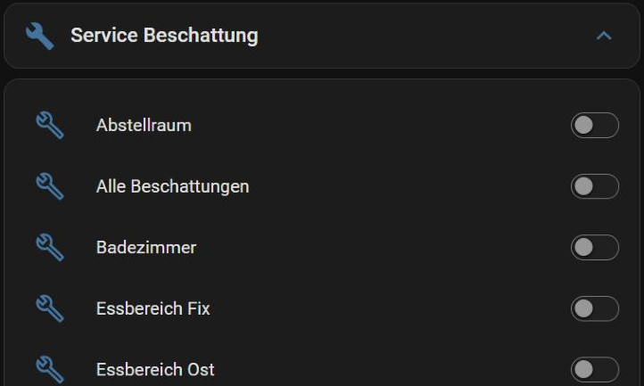

# Aufklapp-Karte

Ueberschrift zum Auf- und Zuklappen mit beliebigen Karten darunter



## Installation

### Über den Marketplace (Home Assistant 2026.11 und neuer)

1. **Einstellungen** → **Marketplace** → **Aus Link hinzufügen**.
2. Die Adresse dieses Repositorys eintragen, Kategorie **Dashboard**.
3. **Aufklapp-Karte** installieren. Die Ressource wird dabei automatisch eingetragen.

### Über HACS (ältere Versionen)

**HACS** → ⋮ → **Benutzerdefinierte Repositories** → Adresse dieses Repositorys, Typ **Dashboard** → installieren.

### Manuell

`aufklapp-karte.js` nach `/config/www/` kopieren und unter **Einstellungen** → **Dashboards** → ⋮ → **Ressourcen**
als JavaScript-Modul `/local/aufklapp-karte.js` eintragen.

## Verwendung

```yaml
type: custom:aufklapp-karte
```

## Konfiguration

```
Aufklapp-Karte: Ueberschrift zum Antippen, darunter beliebige Karten, die ein- und ausgeklappt werden.
Der Zustand (offen/zu) wird pro Geraet im Browser gemerkt.

  type: custom:aufklapp-karte
  titel: Service
  icon: mdi:wrench
  offen: false          # optional, Startzustand
  cards: [ ...Karten... ]
```

## Lizenz

MIT
